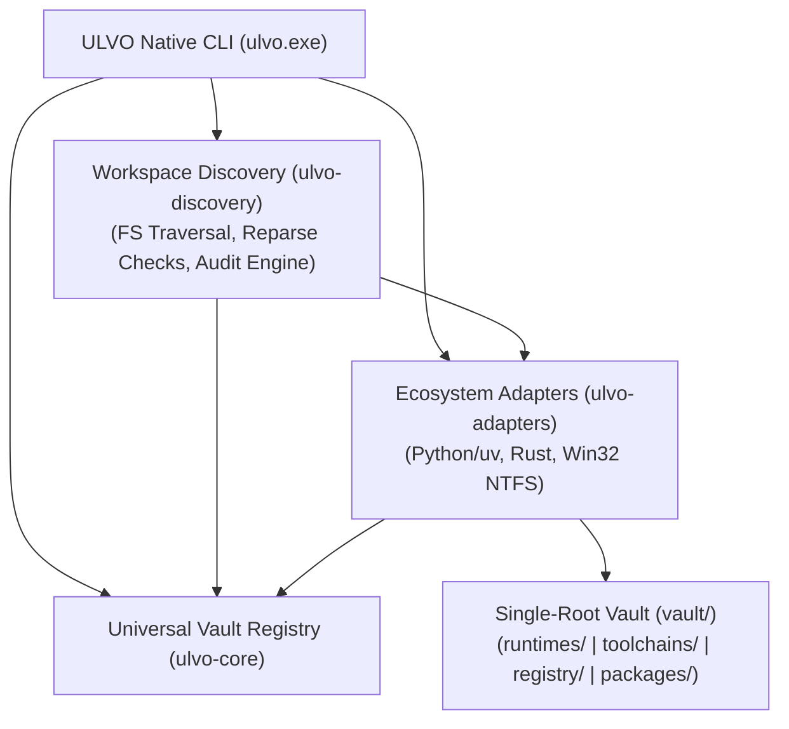

# ULVO — Universal Language & Virtual Environment Orchestrator

ULVO is an early-stage, actively developed universal development-resource control plane. It provides unified governance, inspection, deterministic resource registry tracking, and non-destructive storage intelligence over established language ecosystem managers.

```
       STORE ONCE.
       ISOLATE PER PROJECT.
       MATERIALIZE ON DEMAND.
       EXECUTE THROUGH ULVO.
       RECLAIM SAFELY.
```

> **Current Development Status**: **ULVO Stage 3.3 / v1.2.0 Release Candidate**. ULVO delivers the native Windows Desktop Control Center (`ulvo-desktop.exe`), online verified runtime & tool catalog, universal search query resolution, 10-step transactional provisioning engine, background reconciliation agent (`ulvo-agent.exe`) on local loopback IPC, dual-accounting storage governance with global Win32 inode deduplication across 15 categories, read-only immutable package store, universal multi-ecosystem project onboarding (`ulvo project onboard`), single-entry global gateway on User PATH (`bin\ulvo.exe`) without language pollution, IDE integration blueprint (zero `.venv` sprawl), real-world verified execution on NVIDIA RTX 2050 CUDA GPU, and 182 passing workspace tests.

---

## 1. The Problem ULVO Solves

Modern multi-language software development suffers from resource fragmentation, environment sprawl, and storage waste:

1. **Massive Disk Duplication**: Each project often creates its own isolated virtual environment (`.venv`, `node_modules`, `target`), copying identical large binaries, native wheels (e.g. PySide6, PyTorch, NumPy), and dependencies repeatedly across a single workstation.
2. **Ecosystem Fragmentation**: Developers juggle fragmented CLI tools (`rustup`, `cargo`, `uv`, `poetry`, `pnpm`, `conda`, `nvm`) that store caches, configuration, and runtimes in scattered global directories across the host operating system.
3. **Global State Pollution**: Language tools routinely modify global `PATH`, user profile scripts, or registry entries, making multi-toolchain reproducibility fragile and causing environment collision.
4. **Uncertain Reclamation**: Deleting unused environments is manual and hazardous; developers fear breaking dependencies in co-dependent projects.

---

## 2. Design Philosophy

ULVO operates under five core architectural principles:

- **STORE ONCE**: Download and cache development runtimes, compilers, and external packages exactly once in a centralized content-addressable vault.
- **ISOLATE PER PROJECT**: Ensure every project retains clean dependency isolation without sharing mutable runtime state.
- **MATERIALIZE ON DEMAND**: Project environments are ephemeral projections (via NTFS hardlinks or directory junctions) instantiated when work begins.
- **EXECUTE THROUGH ULVO**: Tools and runtimes execute through the ULVO control plane with process-local environment variables, never polluting global host state.
- **RECLAIM SAFELY**: Inactive ephemeral projections can be unlinked at any time without data loss—project source code remains untouched, and shared assets remain preserved in the persistent vault.

---

## 3. Architecture Overview

ULVO does not reinvent low-level package managers or language compilers. Instead, it serves as a **unified control plane** orchestrating proven, high-performance ecosystem tools:

- **Python**: Leverages `uv` and standard wheels for rapid package caching and resolution.
- **Rust**: Leverages `rustup` and `cargo` inside an isolated single-root runtime vault.
- **JavaScript / TypeScript (Planned)**: Leverages `pnpm` content-addressable storage.
- **Native Windows & Linkers**: Coordinates with MSYS2/UCRT64 and native Win32 toolchains.



For detailed architectural specifications, see [docs/ARCHITECTURE.md](docs/ARCHITECTURE.md).

---

## 4. Current Implemented Functionality

The following capabilities are fully implemented, verified natively on Windows, and covered by automated regression tests:

- **Single-Root Vault**: Directory architecture isolating all managed assets under `vault/`.
- **Windows Rust Provisioning**: Hardened provisioning script (`scripts/provision-rust-windows.ps1`) with pinned artifact hashes, redirect validation, and junction isolation.
- **Native Windows Rust Compilation**: Working native toolchain (`x86_64-pc-windows-gnu`) building all crates and passing all tests without WSL dependence.
- **Universal Vault Registry**: Deterministic resource models (`ResourceId`), conflict rejection, idempotent registration, and lifecycle verification.
- **NTFS Filesystem Identity**: True 64-bit Master File Table file indexing via Win32 `GetFileInformationByHandle`.
- **Physical Disk Allocation**: Cluster allocation measurement using Win32 `GetCompressedFileSizeW`.
- **Python Virtual Environment Discovery**: Detection of virtualenvs, Python versions, editable installs (`direct_url.json`, `.pth`), and native C-extension wheels.
- **Cryptographic Manifest Discrimination**: Evaluation of `.dist-info/WHEEL` ABI tags and `.dist-info/RECORD` SHA-256 digests.
- **Bounded Storage Savings Model**: Three-tier set-theoretic savings model (`Conservative`, `Realistic`, `Theoretical`) without heuristic percentage multipliers.
- **Read-Only Non-Mutating CLI**: Full CLI suite with `--json` output (`inventory`, `inspect`, `vault`, `workspace`, `project`).
- **9-State Ephemeral Environment Lifecycle**: `DEFINED` → `RESOLVED` → `MATERIALIZING` → `READY` → `EXECUTING` → `RELEASED` → `RECLAIMABLE` → `RECLAIMED` / `FAILED` state transitions with persistent ownership sentinels.
- **Specification Fingerprinting**: Cryptographic digest generation across dependency manifests (`requirements.txt`, `pyproject.toml`, `manifest.toml`) to ensure automatic invalidation on dependency drift.
- **Cross-Process Concurrency & Atomic Leases**: Win32 `LockFileEx` exclusive locking with polling backoff and `MoveFileExW` atomic file rename.
- **Win32 Job Object Supervision**: Kernel-level child process termination (`JOB_OBJECT_LIMIT_KILL_ON_JOB_CLOSE`) guarding against lingering background workers.
- **Leaf-First Safe Deletion Engine**: Bottom-up directory traversal rejecting reparse points/junctions and safely clearing read-only attributes with retry backoff.
- **Dual Storage Accounting**: Physical cluster allocation (`GetCompressedFileSizeW`) and volume free-space delta (`GetDiskFreeSpaceExW`).
- **GPU Environment Compatibility Model**: First-class CUDA/GPU typed metadata tracking device compute capability (`sm_86`), NVIDIA display drivers (`596.49`), framework variants (`+cu124` vs `+cpu`), and storage capacity gates.
- **Strict Kernel Driver Boundary Enforcement**: Clear demarcation separating system-managed display drivers from user-space ULVO runtimes; kernel driver relocation is strictly prohibited.
- **Universal Multi-Ecosystem Toolchain Inventory**: Read-only scanning across Windows PATH, known roots, MSYS2, VS Code, and WSL metadata, discovering 29 toolchains across Python, uv, Rust, Node.js, Go, Java, Ruby, .NET, GCC, G++, Clang, CMake, and Ninja.
- **Typed 9-Stage Toolchain Adoption Engine**: Formal state machine (`EXTERNAL_DISCOVERED` -> `COMPATIBILITY_ASSESSED` -> `ADOPTION_PLANNED` -> `STAGING` -> `VERIFIED` -> `MANAGED`) with relocation rejection and rollback verification.
- **Unified Execution Gateway Foundation**: Read-only `GatewayResolver` constructing process-local PATHs and ecosystem environments from Vault Registry identities without global state pollution.
- **Shared Package-Store Hardlinking**: Single-instance immutable package store (`vault/packages/python/shared`) hardlinking large native DLLs and wheels (PyTorch, torchvision) into isolated ephemeral environments with zero redundant disk allocation.
- **Real GPU Deep-Learning Pilot Verification**: End-to-end verified execution of `Academic\sem5\DL\exp1` under ULVO on an NVIDIA RTX 2050 GPU, passing all 9 verification gates (tensor allocation, CUDA forward pass, loss computation, backprop, numerical CPU/GPU parity, and zero legacy `.venv` imports).
- **First-Class Managed MSYS2 C/C++ Toolchain**: Complete managed toolchain (`vault/toolchains/msys2`) with GCC 14.2.0, G++, GNU Make, and Pacman; verified native C (`hello.c`) and C++ (`hello.cpp`) compilation, linking, and execution with zero runtime dependency on external `C:\msys64`.
- **Unified Execution Gateway**: Production CLI gateway (`ulvo exec [--toolchain <name>] -- <cmd...>`) providing process-local PATH and environment isolation with deterministic collision ranking (`Managed` > `External` > `Unknown`).
- **Durable Vault Registry Schema v2**: Persistent registry envelope with cryptographic SHA-256 checksums, cross-process file locking (`vault_registry.lock`), atomic writing, append-only journal (`journal.jsonl`), and corruption detection.
- **Workspace-Wide Storage Recovery Milestone**: Automated retirement of legacy `.venv`s across 5 workspace projects (`exp1`, `exp2`, `server`, `ProofStack`, `whichllm`), recovering **9,791,592,159 bytes (~9.79 GB / 9,337.99 MB)** of verified physical disk space with zero regression in project functionality.
- **Universal Content-Addressable Dependency Store (Stage 2.9.4)**: Immutable cryptographic SHA-256 CAS object storage (`vault/packages/cas`) with pure-Rust zero-dependency streaming hasher (FIPS 180-4), atomic staging, fail-safe reference tracking, and garbage collection of unreferenced artifacts.
- **CAS Immutability & Transactional Materialization Hardening (Stage 2.9.4a)**: Stream copy to private staging with post-copy hash check against concurrent modification, pre-existing object content verification with automatic repair, NTFS read-only file attribute enforcement, 4-phase transactional target materialization with target preservation and rollback on error, fail-closed compatibility validation (rejecting `Unknown` platform/architecture/ABI and enforcing CUDA capability matching), and safe read-only GC planning (`--plan` by default) with journaled unlinking (`gc_journal.jsonl`) and native cache immunity. Supported by a 21-case adversarial test suite.
- **Coordinated Native Package Caching**: Unified telemetry across 7 native package stores (`uv-cache`, `shared wheels`, `cargo registry`, `pnpm-store`, `GOMODCACHE`, `gems`, `pacman pkg`).
- **Machine-Wide Language & Toolchain Adoption**: Discovery of 41 development tools across Windows, MSYS2, and WSL; first-class non-destructive adoption of **Ruby 4.0.1** and **Go 1.26.5** governed by the Vault Registry.
- **Package Store Hardlink Deduplication Engine (Stage 3.2)**: Cryptographic SHA-256 deduplication of identical immutable files between `vault/packages/python/shared` and `vault/packages/python/uv-cache/archive-v0`, freeing **4.412 GB** on drive E: while preserving 100% path integrity and zero project mutation.
- **Build Storage Governance & Disposable Intermediates Pruning (Stage 3.2)**: `ulvo storage build-prune --all` pruning 3,496 disposable compiler intermediates (1,588 MB) while strictly preserving release binaries (`ulvo.exe`, `ulvo-agent.exe`, `ulvo-desktop.exe`, `WebView2Loader.dll`), expanding drive E: free space to **32.84 GB free** (**+8.67 GB** net physical gain).
- **Machine-Wide External Toolchain Inventory & Human Approval Gate (Stage 3.2)**: Discovery and measurement of 6 candidate external installations on `C:` (`C:\msys64`, `nodejs`, `Ruby40-x64`, `Python313`, `Eclipse Adoptium JDK`, `Go`) totaling **11.75 GB** across 337,717 files, with zero files deleted or moved without explicit user sign-off.
- **Unified Multi-Language Execution Gateway (Stage 3.2)**: Process-local execution through ULVO Gateway verified for MSYS2 GCC/G++ 14.2.0, Go 1.26.5, Ruby 4.0.1, Node.js v24.15.0, OpenJDK 21.0.4, and PyTorch 2.6.0+cu124 on physical NVIDIA GeForce RTX 2050 GPU.

---

## 5. Planned Functionality

The following capabilities are in active development or planned for subsequent releases:

- **Desktop Graphical Interface**: Native Windows desktop GUI (Tauri 2.0) based on the comprehensive architectural and branding specification in [docs/GUI_AND_BRANDING_SPECIFICATION.md](docs/GUI_AND_BRANDING_SPECIFICATION.md).
- **Multi-Ecosystem Expansion**: Active execution adapters for Node.js (`pnpm`), Go (`GOMODCACHE`), and Java/JVM.
- **Automated Toolchain Relocation Engine**: Managed staging and relocatability verification pipelines for adopted external runtimes.

---

## 6. Supported Platforms and Limitations

### Supported Platforms
- **Windows 11 / Windows 10 (x86_64)**: Primary supported platform. Full support for NTFS file identity, cluster measurement, and native CLI execution.
- **Ubuntu WSL**: Secondary build and test host. Supports Linux ELF compilation and POSIX device/inode identity.

### Current Limitations
- **Not a Standalone Package Manager**: ULVO orchestrates external toolchains; it does not replace Cargo or PyPI resolvers.
- **No GUI**: All current interaction occurs through the native `ulvo` CLI.
- **Manual Ephemeral Materialization**: Automatic lifecycle management of project virtual environments is planned for Stage 2.8+.
- **In-Situ Payload Verification**: Python package verification hashes distribution manifests (`RECORD`), not whole-disk package payloads, during discovery.
- **Hardlinked Store Caveat**: Package duplication reports logical byte counts; if an upstream tool (such as `uv`) already hardlinked files to a central cache, physical disk savings will be lower.

---

## 7. Repository Structure

```
ULVO/
├── Cargo.toml                    # Workspace definition (4 crates)
├── Cargo.lock                    # Cryptographically locked dependencies
├── config/                       # Pinned toolchain artifact manifests
│   └── toolchain-artifacts.toml
├── crates/
│   ├── ulvo-core/                # Pure domain models, registry, resource IDs (No I/O)
│   ├── ulvo-adapters/            # NTFS identity, Win32 APIs, Python/Rust adapters
│   ├── ulvo-discovery/           # Filesystem traversal, workspace audit engine
│   └── ulvo-cli/                 # Command-line driver and formatters
├── docs/                         # Architecture, CLI, security, and developer guides
├── scripts/                      # Toolchain provisioning and audit scripts
├── tests/                        # Validation harnesses and test fixtures
└── vault/                        # Single-root runtime and registry storage (Git-ignored)
```

---

## 8. Windows-Native Build Instructions

### Prerequisites
- Windows 10 or 11 (NTFS volume)
- Rust 1.96.0+ (or ULVO-managed Rust toolchain)
- MSYS2 UCRT64 GCC linker (`C:\msys64\ucrt64\bin\gcc.exe`)

### Setup and Build

```powershell
# 1. Configure process-local toolchain environment (optional if Rust is on system PATH)
$env:CARGO_HOME = "$PWD\vault\runtimes\rust\cargo"
$env:RUSTUP_HOME = "$PWD\vault\runtimes\rust\rustup"
$env:PATH = "$PWD\vault\runtimes\rust\cargo\bin;C:\msys64\ucrt64\bin;C:\msys64\usr\bin;" + $env:PATH

# 2. Check compilation
cargo check --workspace --locked --target x86_64-pc-windows-gnu

# 3. Run automated tests (60 unit and integration tests)
cargo test --workspace --locked --target x86_64-pc-windows-gnu

# 4. Build native executable
cargo build --workspace --locked --target x86_64-pc-windows-gnu
```

The compiled binary will be located at:
`target\x86_64-pc-windows-gnu\debug\ulvo.exe`

For detailed developer instructions, see [docs/DEVELOPMENT.md](docs/DEVELOPMENT.md).

---

## 9. CLI Usage with Verified Examples

### Workspace Intelligence Scan
Scan a workspace directory to inspect storage, file counts, and categories:
```powershell
.\target\x86_64-pc-windows-gnu\debug\ulvo.exe workspace scan <PATH>
```
*Example Output:*
```text
ULVO Workspace Intelligence Audit (E:\Workspace)
  Scan Status:           INCOMPLETE (41 inaccessible entries)
  Logical Storage:       29.30 GB (316543 files, 314634 unique physical allocations)
  Physical Allocation:   28.85 GB
  Hardlink Deduplication: 1909 files

Top-Level Categories:
  Active                 9.35 GB logical    8.97 GB physical  (8 inaccessible)
  Academic               3.70 GB logical    3.70 GB physical
  Tools                  5.45 GB logical    5.45 GB physical
```

### Storage Savings Projections
Calculate conservative, realistic, and theoretical storage reclamation opportunities:
```powershell
.\target\x86_64-pc-windows-gnu\debug\ulvo.exe workspace savings <PATH> --json
```

### Vault Registry Listing
List all tracked development resources in the Universal Vault Registry:
```powershell
.\target\x86_64-pc-windows-gnu\debug\ulvo.exe vault list --json
```

### Project Diagnostics & Ephemeral Execution
Diagnose project requirements, run commands in an isolated on-demand environment, and reclaim storage safely:
```powershell
# Diagnose manifest syntax, runtimes, and dependencies
ulvo project doctor <PROJECT_PATH>

# Execute command inside vault-managed ephemeral environment
ulvo run <PROJECT_PATH> -- python app.py

# Check environment lifecycle state and process leases
ulvo env status <PROJECT_PATH>

# Reclaim environment storage when quiescent
ulvo env reclaim <PROJECT_PATH>
```

### Workspace Migration & Storage Reclamation
Automate workspace-wide Python virtual-environment scanning, capacity planning, verification, and safe legacy retirement:
```powershell
# Scan workspace to discover all Python environments and project dependencies
ulvo migrate scan E:\Workspace

# Generate capacity-aware, prioritized migration plan with 500 MB reserve
ulvo migrate plan E:\Workspace

# Verify project candidate against 10 pre-retirement safety gates (Gates A-J)
ulvo migrate verify <PROJECT_PATH>

# Synthesize .ulvo/manifest.toml atomically without touching legacy .venv
ulvo migrate apply <PROJECT_PATH>

# Retire legacy environment safely after all gates pass
ulvo migrate retire <PROJECT_PATH> --yes

# View comprehensive migration and storage reclamation summary report
ulvo migrate report E:\Workspace
```

For complete command-line documentation, see [docs/CLI.md](docs/CLI.md).

---

## 10. Universal Vault Registry

The Universal Vault Registry organizes development assets under a deterministic URI schema:
```text
<ecosystem>:<backend>:<category>:<name>:<version>
```
- Tracks ownership (`Managed`, `Configured`, `System`, `Discovered`, `Experimental`).
- Manages verification lifecycle (`Verified`, `Present`, `Configured`, `Stale`, `Failed`).
- Prevents cross-architecture and cross-ABI collisions.

For full technical specifications, see [docs/VAULT_REGISTRY.md](docs/VAULT_REGISTRY.md).

---

## 11. Python/uv Workspace Auditing

The Python adapter discovers and analyzes virtual environments:
- Identifies virtual environment roots via `pyvenv.cfg` or `conda-meta`.
- Discovers installed packages by parsing `.dist-info` directories in `site-packages`.
- Flags native C-extension wheels (`.pyd`, `.so`) and inspects `.dist-info/WHEEL` ABI tags.
- Detects local editable packages (`direct_url.json` and `.pth` files) to protect active projects from premature environment unlinking.

---

## 12. Storage Accounting & Limitations

ULVO measures storage strictly using native filesystem queries:
- **Logical Storage**: Total uncompressed bytes across all file entries.
- **Physical Allocation**: Actual cluster-allocated bytes on disk via `GetCompressedFileSizeW`.
- **Package Duplication**:
  - `[verified identical]`: Packages matching name, version, ABI tag, and RECORD content hash.
  - `[compatible candidate - differing ABI/RECORD]`: Packages matching name and version but differing in binary architecture or build digests. Wasted bytes are attributed strictly to verified identical copies.
- **Savings Hierarchy**:
  $$\text{Conservative} \le \text{Realistic} \le \text{Theoretical} \le \text{Total Workspace}$$

---

## 13. Security & Ownership Model

ULVO is built around a non-mutating, zero-trust execution model:
- **No Global Writes**: Zero writes to system `PATH` or Windows registry.
- **Reparse Point Rejection**: Filesystem traversals reject symlinks and directory junctions to prevent traversal loops and junction hijacking.
- **Process Sentinels**: Test fixtures require `.ulvo_test_sentinel` validation verifying process PID before cleanup.
- **Sandboxed Probes**: Toolchain version checks use null stdin, bounded 64 KiB capture buffers, and 3-second hard timeouts.

For complete security specifications, see [docs/SECURITY.md](docs/SECURITY.md).

---

## 14. Development Roadmap

- **Phase 0**: Security and model foundation [COMPLETED]
- **Stage 2.4 – 2.5**: Windows Rust provisioning and native compilation [COMPLETED]
- **Stage 2.6**: Universal Vault Registry foundation [COMPLETED]
- **Stage 2.7 – 2.7.1**: Workspace intelligence and NTFS file identity [COMPLETED]
- **Stage 2.8 – 2.8.2**: Ephemeral Python environment lifecycle & NexusNode retirement [COMPLETED]
- **Stage 2.9**: Automated workspace-wide Python migration & storage reclamation [COMPLETED]
- **Stage 2.9.1**: GPU-aware orchestration, toolchain inventory & pilot verification [COMPLETED]
- **Stage 2.9.2**: Managed MSYS2 provisioning, execution gateway & deep learning retirements [COMPLETED]
- **Stage 2.9.2a**: Emergency storage recovery, toolchain consolidation & gateway hardening [COMPLETED]
- **Stage 2.9.3**: Lightweight project integration contract & universal connector governance [COMPLETED]
- **Stage 2.9.4**: Universal Content-Addressable Dependency Store & machine-wide language adoption [COMPLETED]
- **Stage 2.9.4a**: CAS immutability, transactional materialization & adversarial hardening [COMPLETED]
- **Stage 1.0.0**: System-wide consolidation, single gateway, universal catalog, and release readiness [COMPLETED]
- **Stage 3.0**: Zero persistent project environments, automatic ephemeral reclamation & storage cache governance [COMPLETED]
- **Stage 3.0.1**: Priority Zero storage recovery (+19.73 GB), exact accounting, cache governance CLI & lifecycle hardening [COMPLETED]
- **Stage 3.1**: Desktop Control Center (Tauri 2.0 GUI) [BLOCKED pending host Tauri build prerequisites]

For roadmap details, see [docs/ROADMAP.md](docs/ROADMAP.md).

---

## 15. Contributing & Development Status

ULVO is currently in pre-release development. Contributions, feedback, and issue reports are welcome.

Before submitting contributions:
1. Ensure all changes compile with `cargo check --workspace --locked --target x86_64-pc-windows-gnu`.
2. Ensure all tests pass with `cargo test --workspace --locked --target x86_64-pc-windows-gnu`.
3. Adhere to the core invariants in [docs/SECURITY.md](docs/SECURITY.md) and [docs/DEVELOPMENT.md](docs/DEVELOPMENT.md).

---

## 16. Documentation Index

- [Architecture Specification](docs/ARCHITECTURE.md)
- [CLI Reference Manual](docs/CLI.md)
- [Universal Vault Registry Guide](docs/VAULT_REGISTRY.md)
- [Security & Safety Model](docs/SECURITY.md)
- [Development & Build Guide](docs/DEVELOPMENT.md)
- [Development Roadmap](docs/ROADMAP.md)
- [Project Changelog](CHANGELOG.md)
- [Stage 2.7.1 Workspace Audit Report](docs/STAGE2_7_WORKSPACE_AUDIT_REPORT.md)
