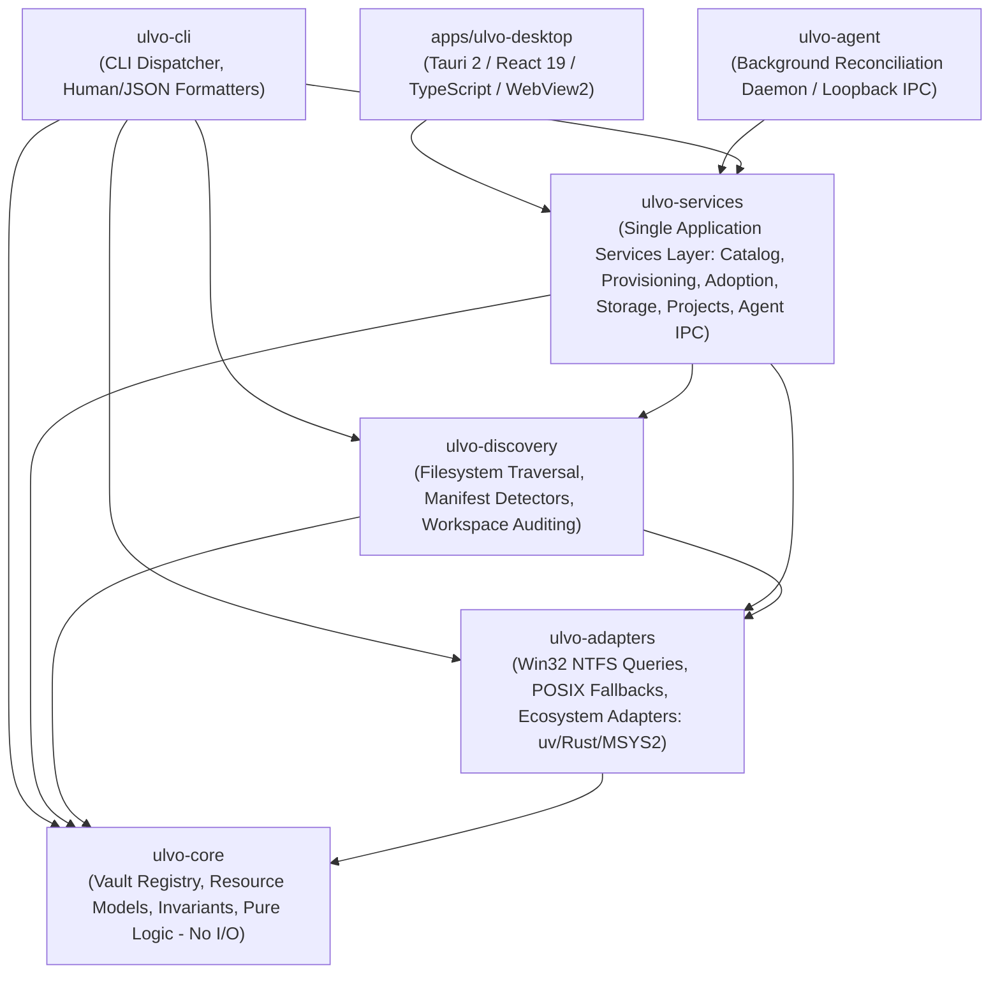
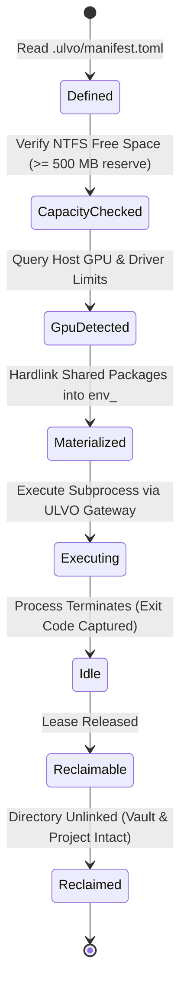

# ULVO Architecture Specification

ULVO (**Universal Language & Virtual Environment Orchestrator**) is an early-stage, actively developed universal development-resource control plane.

```
       STORE ONCE.
       ISOLATE PER PROJECT.
       MATERIALIZE ON DEMAND.
       EXECUTE THROUGH ULVO.
       RECLAIM SAFELY.
```

ULVO operates as a unified governance and orchestration layer above established ecosystem tools—including `uv`, `rustup`, `cargo`, `pnpm`, and future runtime managers—providing a single-root vault, deterministic resource registry, cross-language project inspection, and non-destructive storage optimization.

---

## 1. System Layers

ULVO is organized into a modular Cargo workspace comprising six Rust crates and a native Windows desktop application, strictly separating domain invariants, platform adapters, traversal/discovery, shared application services, the background reconciliation daemon, the CLI, and the desktop control center.

Operational caveats and current persistence/allocation semantics are specified in [workstation hardening](WORKSTATION_HARDENING.md). In particular, project-registry writes use a separate Windows OS lock plus stale-snapshot detection; ordinary NTFS file allocation uses `FileStandardInfo` rather than logical length from a compressed-size query.



### `ulvo-core`
- **Responsibility**: Pure domain models and deterministic business logic. Strictly zero I/O and zero subprocess execution.
- **Key Modules**:
  - [`registry`](../crates/ulvo-core/src/registry.rs): In-memory and serializable Universal Vault Registry, conflict detection, idempotent registration, reconciliation state machine, host GPU hardware tracking, toolchain adoption plan store, file-locking concurrency (`vault_registry.lock`), append-only journaling (`journal.jsonl`), and cryptographic SHA-256 payload verification.
  - [`resource`](../crates/ulvo-core/src/resource.rs): `ManagedResource`, deterministic `ResourceId` hashing, `OwnershipCategory`, `VerificationState`, `ResourceCapabilities`, and ABI/architecture specifications.
  - [`workspace`](../crates/ulvo-core/src/workspace.rs): Storage accounting models, `WorkspaceAuditReport`, `PythonEnvironment`, `InstalledPackage`, `PackageDuplication`, and mathematically bounded `StorageSavingsReport`.
  - [`gpu`](../crates/ulvo-core/src/gpu.rs): GPU device descriptors, CUDA compute capability (`sm_86`), NVIDIA driver version to CUDA mapping, Deep Learning framework variant models (`+cu124` vs `+cpu`), CUDA runtime dynamic dependency graphs, and drive capacity threshold gates.
  - [`adoption`](../crates/ulvo-core/src/adoption.rs): 9-stage universal toolchain adoption lifecycle (`ExternalDiscovered` -> `CompatibilityAssessed` -> `AdoptionPlanned` -> `Staging` -> `Verified` -> `Managed`), migration strategies (`InPlaceManaged`, `CopyRelocatable`, `ReferenceExternal`), rollback manifests, and fail-closed safety rejection rules.
  - [`manifest`](../crates/ulvo-core/src/manifest.rs): Thin Project Connector Contract (`ConnectorContract`, `ConnectorComplianceVerdict`), size budget constants (`CONNECTOR_TARGET_BUDGET_BYTES` = 100 KiB, `CONNECTOR_MAX_BUDGET_BYTES` = 10 MiB), prohibited environment artifact rules, and multi-ecosystem manifest models (`NodeManifestConfig`, `RustManifestConfig`, `CppManifestConfig`, `JavaManifestConfig`, `GoManifestConfig`, `RubyManifestConfig`).
  - [`cas`](../crates/ulvo-core/src/cas.rs): Content-Addressable Storage data models, SHA-256 digest validation, artifact metadata, and CAS deduplication accounting.
  - [`onboarding`](../crates/ulvo-core/src/onboarding.rs): Universal project onboarding models (`OnboardingPolicy` [Manual, Prompt, Auto], `EcosystemKind`, `DetectedEcosystem`, `ProjectOnboardingReport`, `OnboardResult`).

### `ulvo-adapters`
- **Responsibility**: Host platform interactions and ecosystem-specific inspectors.
- **Key Modules**:
  - [`fs_identity`](../crates/ulvo-adapters/src/fs_identity.rs): Native Windows Win32 API calls (`CreateFileW` with `FILE_READ_ATTRIBUTES` and `FILE_FLAG_BACKUP_SEMANTICS | FILE_FLAG_OPEN_REPARSE_POINT`, `GetFileInformationByHandle` for 64-bit file indices, `GetCompressedFileSizeW` for physical cluster allocation), POSIX `st_dev`/`st_ino` fallbacks, FIPS 180-4 standard SHA-256 calculation, and cross-volume-safe single-instance `hardlink_or_copy_tree` materialization.
  - [`cas_storage`](../crates/ulvo-adapters/src/cas_storage.rs): Transactional CAS payload storage, immutable read-only protection, and verified hardlinking into environments.
  - [`vault_python`](../crates/ulvo-adapters/src/vault_python.rs): Python virtual environment inspection (`pyvenv.cfg`, `conda-meta`), `site-packages` analysis, editable install detection (`direct_url.json` and `.pth` imports), `.dist-info/WHEEL` ABI tag extraction, distribution cryptographic catalog digest verification (`RECORD`/`METADATA`), and duplication analysis.
  - [`vault_uv`](../crates/ulvo-adapters/src/vault_uv.rs): `uv` ecosystem integration, ephemeral environment provisioning, single-instance shared package caching (`vault/packages/python/shared`), wheel pre-seeding, and non-destructive cleanup.
  - [`vault_rust`](../crates/ulvo-adapters/src/vault_rust.rs): Rust toolchain inspection inside the managed vault, `settings.toml` parsing, and PE/ELF binary header validation.
  - [`vault_msys2`](../crates/ulvo-adapters/src/vault_msys2.rs): First-class managed MSYS2 C/C++ toolchain subsystem manager (`Ucrt64`, `Mingw64`, `Clang64`, `Msys`), adopting external or provisioned installations into `vault/toolchains/msys2`, `.ulvo_managed.json` sentinel verification, and native C/C++ compilation test harnesses.
  - [`gateway`](../crates/ulvo-adapters/src/gateway.rs): Unified Execution Gateway (`GatewayResolver`, `ProcessContext`, `ulvo exec`) constructing process-isolated toolchain `PATH` and ecosystem variables without global PATH or Windows registry pollution. Hardened with strict Windows system directory allowlisting (`System32`, `Wbem`, `WindowsPowerShell`), deterministic collision ranking (`Managed` > `External` > `Unknown`, verified status, semver ranking), and ecosystem-specific environment setups.

### `ulvo-discovery`
- **Responsibility**: Safe filesystem traversal, workspace scanning, multi-ecosystem manifest detection, and lifecycle orchestration.
- **Key Modules**:
  - [`connector`](../crates/ulvo-discovery/src/connector.rs): Thin Project Connector Audit Engine (`audit_project_connector`), recursive directory scanning, reparse point rejection, prohibited artifact detection, single file size limits (1 MiB), and native manifest cross-referencing.
  - [`vault`](../crates/ulvo-discovery/src/vault.rs): Single-root vault management, durable envelope persistence, `load_vault_registry_readonly` for zero-mutation queries, atomic transaction execution via `with_vault_registry_transaction`, corrupt state backup (`vault_registry.corrupt.<timestamp>.json`), and fail-closed journaling.
  - [`workspace_audit`](../crates/ulvo-discovery/src/workspace_audit.rs): Safe read-only recursive traversal, junction/symlink reparse point rejection, inaccessible directory tracking, physical cluster accumulation without double-counting, and non-mutating storage savings estimation.
  - [`workspace_migration`](../crates/ulvo-discovery/src/workspace_migration.rs): Workspace-wide Python virtual environment discovery, 7-stage migration lifecycle, safety gate evaluation, and conditional retirement planning.
  - [`project_lifecycle`](../crates/ulvo-discovery/src/project_lifecycle.rs): End-to-end ephemeral environment lifecycle, host GPU querying (`detect_host_gpu`), NTFS capacity checking with 500 MB safety reserves, project manifest loading, execution supervision, and reclaimable lease cleanup.
  - [`toolchain_inventory`](../crates/ulvo-discovery/src/toolchain_inventory.rs): Universal toolchain scanner inspecting Windows PATH, known toolchain roots, MSYS2 (`C:\msys64`), VS Code configuration, and read-only WSL registry keys across 18+ ecosystem binary families.
  - [`lock`](../crates/ulvo-discovery/src/lock.rs): File-based concurrency control and execution lease management.
  - [`onboarding`](../crates/ulvo-discovery/src/onboarding.rs): Universal project onboarding engine (`ProjectOnboardingEngine`) providing recursive ecosystem scanning, monorepo container traversal, and thin connector manifest generation.

### `ulvo-services`
- **Responsibility**: Single application-services business logic layer serving CLI, GUI, and background agent without duplicate domain implementations.
- **Key Modules**:
  - [`catalog`](../crates/ulvo-services/src/catalog.rs): Verified online runtime and tool catalog provider (Python, uv, Rust, MSYS2/GCC, Go, Ruby, Node.js, Java, CMake, Ninja) and Universal Search Query Parser resolving ecosystem ambiguity into typed intents.
  - [`provisioning`](../crates/ulvo-services/src/provisioning.rs): 10-step transactional provisioning engine (`Discover` -> `Resolve` -> `Plan` -> `Download` -> `Verify` -> `Stage` -> `Install` -> `Validate` -> `Register` -> `Commit`) with streaming SHA-256 CAS verification, capacity preflight checks (500 MB floor), and atomic rollback.
  - [`adoption`](../crates/ulvo-services/src/adoption.rs): Machine-wide installation discovery scanner (querying `where.exe` across 18+ tools and GPU telemetry), classifying targets into 6 discovery states (`Managed`, `External`, `Adoptable`, `SystemManaged`, `Blocked`, `Unknown`).
  - [`storage`](../crates/ulvo-services/src/storage.rs): Dual-accounting storage governance (logical vs cluster allocation via `GetCompressedFileSizeW`), hardlink sharing ratio, and cache pruning/LRU GC.
  - [`build_governance`](../crates/ulvo-services/src/build_governance.rs): Durable build storage governance, classifying build artifacts into `Essential` (release binaries, sources, manifests), `Reusable` (package caches), and `Disposable` (compiler intermediates, debug objects, incremental caches), with fail-closed compiler liveness protection (detecting active `rustc`, `gcc`, `link`, `ld` processes and `.cargo-lock` locks) before executing safe storage pruning.
  - [`projects`](../crates/ulvo-services/src/projects.rs): Project registry, connector initialization, and structured ephemeral environment execution.
  - [`agent_ipc`](../crates/ulvo-services/src/agent_ipc.rs): Local loopback TCP IPC protocol on `127.0.0.1:48590` with secret bearer token auth (`vault/agent.token`).

### `ulvo-agent`
- **Responsibility**: Lightweight per-user background daemon (`ulvo-agent.exe`) performing continuous lease monitoring, orphaned environment reclamation, cache lifecycle governance, and IPC request handling.

### `apps/ulvo-desktop`
- **Responsibility**: Production-grade Windows desktop application built with Tauri 2.0, Microsoft Edge WebView2 Evergreen, React 19, and TypeScript. Provides an accessible, dark-first cockpit with eight core views: Dashboard, Discover, Installed, Projects, Storage, GPU Copilot, Adoption, and Activity/Settings.

### `ulvo-cli`
- **Responsibility**: Command dispatching, input validation, human-readable terminal rendering, and strict JSON output serialization.

---

## 2. Single-Root Vault Architecture

ULVO adopts a single-root filesystem architecture. All managed runtimes, toolchains, package caches, temporary project environments, and registry metadata are isolated under a single dedicated directory structure:

```
<ULVO_ROOT>/
├── bin/                          # ULVO orchestrator executable (ulvo.exe)
├── config/                       # Static manifests and artifact definitions
│   └── toolchain-artifacts.toml # Cryptographically pinned toolchain releases
├── vault/                        # Single-root managed storage
│   ├── runtimes/                 # Fully isolated runtimes (e.g. rustup, python)
│   │   └── rust/                 # Managed Rust toolchain
│   │       ├── cargo/            # Isolated CARGO_HOME
│   │       └── rustup/           # Isolated RUSTUP_HOME
│   ├── toolchains/               # Managed toolchains and adopted compilers
│   │   └── msys2/                # Managed MSYS2 C/C++ toolchain (.ulvo_managed.json)
│   │       ├── ucrt64/           # UCRT64 GCC, G++, Clang, headers, binutils
│   │       ├── usr/              # MSYS POSIX core utilities & shell
│   │       ├── etc/              # Pacman & environment configurations
│   │       └── var/lib/pacman/   # Pacman package database
│   ├── packages/                 # Shared content-addressable package store
│   │   └── python/shared/        # Single-instance package trees (hardlinked into venvs)
│   ├── environments/             # Ephemeral materialized project virtualenvs (env_<hash>)
│   ├── registry/                 # Persistent Universal Vault Registry state (JSON)
│   │   ├── vault_registry.lock   # Concurrency lockfile for atomic multi-process updates
│   │   └── journal.jsonl         # Append-only transaction journal
│   └── tmp/                      # Ephemeral workspace files with ownership guards
├── crates/                       # Rust implementation source code
├── scripts/                      # Hardened provisioning and audit scripts
└── docs/                         # Specifications, architecture, and verification logs
```

---

## 3. Universal Vault Registry

The **Universal Vault Registry** is the central ledger of all development resources tracked by ULVO. It solves the fragmentation of development environments where different tools store metadata in ad-hoc locations.

### Deterministic Resource Identifiers
Resources are identified by a deterministic URI schema:
```text
<ecosystem>:<backend>:<category>:<name>:<version>
```
- Examples:
  - `rust:windows:managed:rustc:1.96.0`
  - `python:windows:external:python:3.11.9`
  - `python:windows:discovered:cffi:1.17.1`

### Identity Guarantees
- **Case Normalization**: Windows filesystem paths are canonicalized and lowercased for comparison; POSIX paths preserve exact casing.
- **Collision Prevention**: Separate fields for architecture (e.g. `x86_64`), ABI (e.g. `gnu` vs `msvc`, `cp311` vs `cp312`), and backend (`windows` vs `wsl`) ensure distinct resources never collide.
- **Reconciliation Engine**:
  - **Idempotency**: Registering an identical resource returns `Ok(false)` without mutating state.
  - **Conflict Detection**: Registering conflicting attributes at an identical path is rejected with `Err`.
  - **Staleness Tracking**: Resources whose on-disk files are missing or modified transition to `VerificationState::Stale` or `VerificationState::Failed`.

---

## 4. Ephemeral Environment Lifecycle

The governing lifecycle model for ephemeral execution:



1. **STORE ONCE**: Heavy packages (e.g. `torch_cuda.dll`, NumPy, CUDA runtimes) are stored once under `vault/packages/python/shared`.
2. **ISOLATE PER PROJECT**: Each project contains a minimal `.ulvo/manifest.toml` declaring dependencies and entrypoints.
3. **MATERIALIZE ON DEMAND**: On project invocation, NTFS hardlinks project the shared package trees into an ephemeral directory under `vault/environments/env_<hash>`. Zero bytes duplicated on same volume; zero network downloads.
4. **EXECUTE THROUGH ULVO**: The unified gateway constructs a dedicated process context with toolchain directories prepend-isolated on local PATH, executing the workload without global mutation.
5. **RECLAIM SAFELY**: When execution completes, the ephemeral environment is marked reclaimable and cleaned up cleanly.

---

## 5. Host & Toolchain Coexistence Boundaries

| Environment | Role in ULVO | Execution Policy |
| :--- | :--- | :--- |
| **Windows Native** | **Primary target**: ULVO executes natively (`x86_64-pc-windows-gnu`). All NTFS operations use Win32 file APIs. | Native Win32 subprocess execution with strict timeouts, gateway environment isolation, and output capture. |
| **MSYS2 / UCRT64** | **Bootstrap & Linker / Vault-Managed Native Toolchain**: Provides `gcc.exe`, `g++.exe`, and GNU binutils for native Windows linking and compilation. | External `C:\msys64` coexists completely untouched. ULVO provisions a first-class managed MSYS2 installation under `vault/toolchains/msys2` with `.ulvo_managed.json` sentinel and verified native C/C++ compilation. |
| **WSL (Ubuntu)** | **Secondary host / verification**: Linux ELF build host used for cross-platform regression checks. | Registry-only discovery. Linux execution strictly isolated from Windows host processes. Direct cross-boundary execution without proxy is rejected. |

---

## 6. Feature Implementation Status

To maintain engineering clarity, all ULVO features are strictly categorized into one of four states:

| Feature | Status | Notes |
| :--- | :--- | :--- |
| **Single-Root Vault Storage** | `IMPLEMENTED` | Standard directory tree under `vault/` with process-local environment redirection. |
| **Windows Rust Provisioning** | `IMPLEMENTED` | Hardened PowerShell script (`scripts/provision-rust-windows.ps1`) with redirect validation, SHA-256 verification, and junction isolation. |
| **Native Windows Rust Compilation** | `IMPLEMENTED` | Fully working native toolchain (`x86_64-pc-windows-gnu`) building all crates. |
| **Universal Vault Registry Foundation** | `IMPLEMENTED` | Deterministic models, conflict detection, verification lifecycle, GPU models, toolchain adoption plans, and JSON export in `ulvo-core`. |
| **Durable Vault Registry v2** | `IMPLEMENTED` | Atomic file locking (`vault_registry.lock`), append-only transaction journal (`journal.jsonl`), and cryptographic SHA-256 payload integrity check. |
| **NTFS Filesystem Identity** | `IMPLEMENTED` | Handle-based volume serial and file index queries (`CreateFileW` + `GetFileInformationByHandle`). |
| **Physical Disk Allocation Accounting** | `IMPLEMENTED` | Cluster-level allocation measurement via `GetCompressedFileSizeW`. |
| **Python/uv Environment Discovery** | `IMPLEMENTED` | Discovers virtualenvs, parses `pyvenv.cfg`, identifies native wheels, editable installs, and RECORD digests. |
| **Bounded Storage Savings Model** | `IMPLEMENTED` | Three-tier mathematical model (`Conservative`, `Realistic`, `Theoretical`) without heuristic percentage multipliers. |
| **Process-Safe Test Fixtures** | `IMPLEMENTED` | Random/timestamped fixture paths with `.ulvo_test_sentinel` PID ownership validation. |
| **Controlled Ephemeral Python Execution** | `IMPLEMENTED` | Verified in Stage 2.8/2.8.1 with `NexusNode/server` running completely venv-free. |
| **Safe Virtualenv Retirement Lifecycle** | `IMPLEMENTED` | Verified across workspace in Stage 2.9/2.9.2 (5 projects retired, ~9.79 GB physical storage reclaimed, drive E: free space expanded to 11.44 GB). |
| **Shared Package-Store Hardlinking** | `IMPLEMENTED` | Implemented in Stage 2.9.1 via `vault/packages/python/shared` and `hardlink_or_copy_tree`. |
| **GPU Compatibility & Driver Governance** | `IMPLEMENTED` | Implemented in Stage 2.9.1 via `ulvo-core::gpu`, `nvidia-smi` hardware detection, CUDA compute capability mapping, and driver safety guardrails. |
| **Universal Toolchain Inventory** | `IMPLEMENTED` | Implemented in Stage 2.9.1 via `ulvo-discovery::toolchain_inventory`, scanning Windows PATH, MSYS2, VS Code, and WSL registry metadata. |
| **Staged Toolchain Adoption Model** | `IMPLEMENTED` | Implemented in Stage 2.9.1 via `ulvo-core::adoption` (9-stage lifecycle, fail-closed relocation rules). |
| **First-Class Managed MSYS2 C/C++ Toolchain** | `IMPLEMENTED` | Implemented in Stage 2.9.2 via `vault/toolchains/msys2` with `.ulvo_managed.json`, native C/C++ verification (`ulvo toolchain msys2 verify`), and zero mutation of external `C:\msys64`. |
| **Unified Execution Gateway (`ulvo exec`)** | `IMPLEMENTED` | Implemented in Stage 2.9.2 via `ulvo exec [--toolchain <name>] -- <cmd...>` routing commands directly to vault-managed toolchains with isolated PATH. |
| **Desktop GUI Control Plane** | `IMPLEMENTED` | Implemented in Stage 3.1 (`apps/ulvo-desktop`) using Tauri 2.0, React 19, TypeScript, and Microsoft Edge WebView2 Evergreen across eight dark-first cockpit views. |
| **Background Reconciliation Agent** | `IMPLEMENTED` | Implemented in Stage 3.1 (`crates/ulvo-agent`) with authenticated loopback TCP IPC on `127.0.0.1:48590` (`vault/agent.token`). |
| **Universal Online Catalog & Search** | `IMPLEMENTED` | Implemented in Stage 3.1 (`crates/ulvo-services::catalog`) supporting 10 verified toolchains and universal ambiguity-resolving search. |
| **10-Step Transactional Provisioning Engine** | `IMPLEMENTED` | Implemented in Stage 3.1 (`crates/ulvo-services::provisioning`) with streaming SHA-256 CAS verification, capacity preflight checks (500 MB floor), and atomic rollback. |
| **Machine-Wide Discovery & Adoption** | `IMPLEMENTED` | Implemented in Stage 3.1 (`crates/ulvo-services::adoption`) classifying host installations into 6 explicit discovery states. |
| **Production Installer & Distribution** | `IMPLEMENTED` | Implemented in Stage 3.1 via `scripts/package-release.ps1`, `scripts/install-ulvo.ps1`, `scripts/uninstall-ulvo.ps1`, and portable zip bundle (`dist/`). |
| **Node.js / pnpm Adapter** | `IMPLEMENTED` | Catalog entry, universal search resolution, and `.ulvo/manifest.toml` thin connector parsing for JavaScript/TypeScript runtimes. |
| **Go / Java / Ruby / .NET Adapters** | `IMPLEMENTED` | Catalog entries, execution gateway resolution, and thin connector dependency models for Go, JVM, Ruby, and .NET. |
| **Universal Multi-Ecosystem Onboarding Engine** | `IMPLEMENTED` | Implemented in Stage 3.3 (`ulvo project onboard`) supporting recursive detection of 7 ecosystems, monorepo container traversal, and thin connector initialization. |
| **Physical Runtime Independence & Pinned uv Vendoring** | `IMPLEMENTED` | Implemented in Stage 3.4 (`vault/bin/uv.exe` v0.13.1 SHA-256 pinned and standalone CPython 3.11.16 in `vault/runtimes/python`), removing execution reliance on host C: installations. |
| **Package Store Inode Severing & Safety Hardening** | `IMPLEMENTED` | Implemented in Stage 3.4 verifying NTFS atomic replacement (`MoveFileExW`) inode allocation and read-only attributes across 17,714 package store files. |
| **Fast Warm Execution Optimization** | `IMPLEMENTED` | Implemented in Stage 3.4 reducing warm `ulvo run` launch latency from 1614 ms to 157 ms (10.28x speedup) and `ulvo project status` to 84 ms. |
| **Storage & Retirement Matrix Reconciliation** | `IMPLEMENTED` | Implemented in Stage 3.4 providing exact mathematical proof for decimal/binary equivalence (24.17 GB = 22.509 GiB), volume measurements (E: 30.19 GB free, C: 20.86 GB free), and zero C: host tool deletions. |
| **Foreign Distribution Execution** | `BLOCKED` | Cross-boundary execution between Windows and WSL without explicit launcher. |


