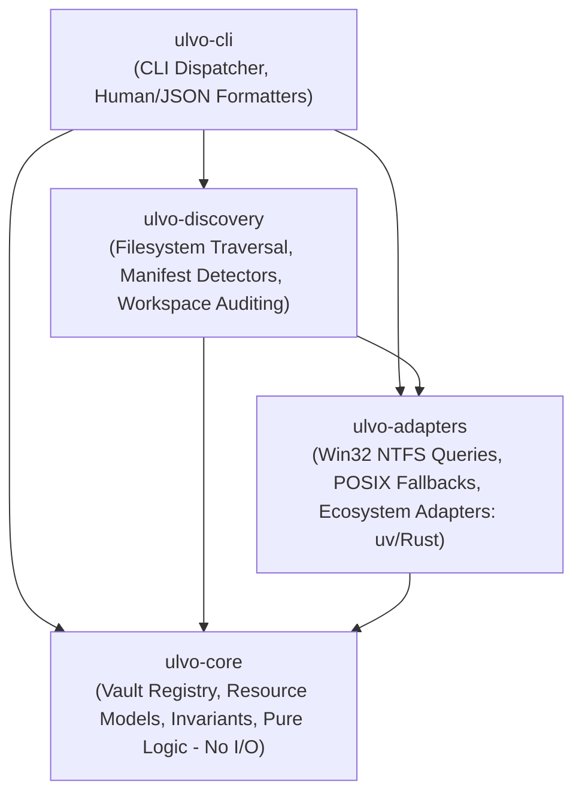
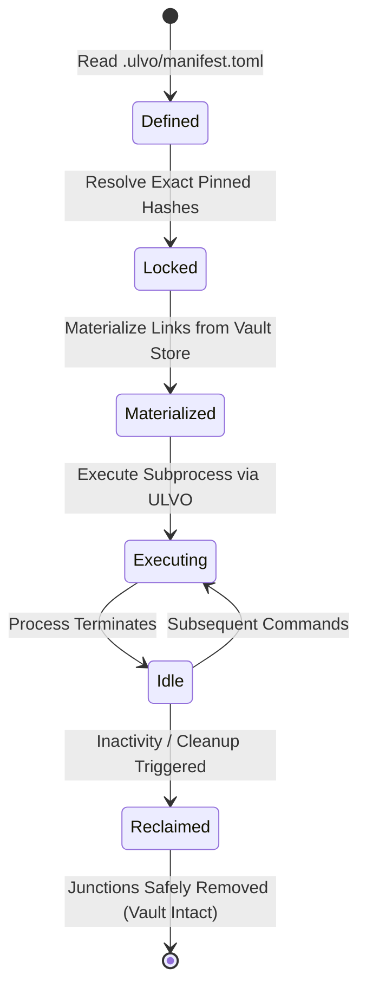

# ULVO Architecture Specification

ULVO (**Universal Language & Virtual Environment Orchestrator**) is an early-stage, actively developed universal development-resource control plane.

```
       STORE ONCE.
       ISOLATE PER PROJECT.
       MATERIALIZE ON DEMAND.
       EXECUTE THROUGH ULVO.
       RECLAIM SAFELY.
```

ULVO operates as a unified governance and orchestration layer above established ecosystem tools—including `uv`, `rustup`, `cargo`, `pnpm`, and future runtime managers—providing a single-root vault, deterministic resource registry, cross-language project inspection, and non-destructive storage optimization.

---

## 1. System Layers

ULVO is organized into a four-crate Cargo workspace, strictly separating pure data models from host I/O, discovery algorithms, and the command-line interface.



### `ulvo-core`
- **Responsibility**: Pure domain models and deterministic business logic. Strictly zero I/O and zero subprocess execution.
- **Key Modules**:
  - [`registry`](../crates/ulvo-core/src/registry.rs): In-memory and serializable Universal Vault Registry, conflict detection, idempotent registration, and reconciliation state machine.
  - [`resource`](../crates/ulvo-core/src/resource.rs): `ManagedResource`, deterministic `ResourceId` hashing, `OwnershipCategory`, `VerificationState`, `ResourceCapabilities`, and ABI/architecture specifications.
  - [`workspace`](../crates/ulvo-core/src/workspace.rs): Storage accounting models, `WorkspaceAuditReport`, `PythonEnvironment`, `InstalledPackage`, `PackageDuplication`, and mathematically bounded `StorageSavingsReport`.

### `ulvo-adapters`
- **Responsibility**: Host platform interactions and ecosystem-specific inspectors.
- **Key Modules**:
  - [`fs_identity`](../crates/ulvo-adapters/src/fs_identity.rs): Native Windows Win32 API calls (`CreateFileW` with `FILE_READ_ATTRIBUTES` and `FILE_FLAG_BACKUP_SEMANTICS | FILE_FLAG_OPEN_REPARSE_POINT`, `GetFileInformationByHandle` for 64-bit file indices, `GetCompressedFileSizeW` for physical cluster allocation), POSIX `st_dev`/`st_ino` fallbacks, and FIPS 180-4 standard SHA-256 calculation.
  - [`vault_python`](../crates/ulvo-adapters/src/vault_python.rs): Python virtual environment inspection (`pyvenv.cfg`, `conda-meta`), `site-packages` analysis, editable install detection (`direct_url.json` and `.pth` imports), `.dist-info/WHEEL` ABI tag extraction, distribution cryptographic catalog digest verification (`RECORD`/`METADATA`), and duplication analysis.
  - [`vault_rust`](../crates/ulvo-adapters/src/vault_rust.rs): Rust toolchain inspection inside the managed vault, `settings.toml` parsing, and PE/ELF binary header validation.

### `ulvo-discovery`
- **Responsibility**: Safe filesystem traversal, workspace scanning, and multi-ecosystem manifest detection.
- **Key Modules**:
  - [`workspace_audit`](../crates/ulvo-discovery/src/workspace_audit.rs): Safe read-only recursive traversal, junction/symlink reparse point rejection, inaccessible directory tracking, physical cluster accumulation without double-counting, and non-mutating storage savings estimation.
  - [`vault`](../crates/ulvo-discovery/src/vault.rs): Local vault directory scanning, resource discovery, and registry reconciliation against on-disk states.
  - [`lib`](../crates/ulvo-discovery/src/lib.rs): Host PATH scanning, VS Code configuration reference detection, and native project manifest recognition (`Cargo.toml`, `package.json`, `pyproject.toml`, `.ulvo/manifest.toml`).

### `ulvo-cli`
- **Responsibility**: Command dispatching, input validation, human-readable terminal rendering, and strict JSON output serialization.

---

## 2. Single-Root Vault Architecture

ULVO adopts a single-root filesystem architecture. All managed runtimes, toolchains, package caches, temporary project environments, and registry metadata are isolated under a single dedicated directory structure:

```
<ULVO_ROOT>/
├── bin/                          # ULVO orchestrator executable (ulvo.exe)
├── config/                       # Static manifests and artifact definitions
│   └── toolchain-artifacts.toml # Cryptographically pinned toolchain releases
├── vault/                        # Single-root managed storage
│   ├── runtimes/                 # Fully isolated runtimes (e.g. rustup, python)
│   │   └── rust/                 # Managed Rust toolchain
│   │       ├── cargo/            # Isolated CARGO_HOME
│   │       └── rustup/           # Isolated RUSTUP_HOME
│   ├── toolchains/               # External toolchain reference pointers
│   ├── packages/                 # Shared content-addressable package store (future)
│   ├── environments/             # Ephemeral materialized project virtualenvs (future)
│   ├── registry/                 # Persistent Universal Vault Registry state (JSON)
│   └── tmp/                      # Ephemeral workspace files with ownership guards
├── crates/                       # Rust implementation source code
├── scripts/                      # Hardened provisioning and audit scripts
└── docs/                         # Specifications, architecture, and verification logs
```

---

## 3. Universal Vault Registry

The **Universal Vault Registry** is the central ledger of all development resources tracked by ULVO. It solves the fragmentation of development environments where different tools store metadata in ad-hoc locations.

### Deterministic Resource Identifiers
Resources are identified by a deterministic URI schema:
```text
<ecosystem>:<backend>:<category>:<name>:<version>
```
- Examples:
  - `rust:windows:managed:rustc:1.96.0`
  - `python:windows:external:python:3.11.9`
  - `python:windows:discovered:cffi:1.17.1`

### Identity Guarantees
- **Case Normalization**: Windows filesystem paths are canonicalized and lowercased for comparison; POSIX paths preserve exact casing.
- **Collision Prevention**: Separate fields for architecture (e.g. `x86_64`), ABI (e.g. `gnu` vs `msvc`, `cp311` vs `cp312`), and backend (`windows` vs `wsl`) ensure distinct resources never collide.
- **Reconciliation Engine**:
  - **Idempotency**: Registering an identical resource returns `Ok(false)` without mutating state.
  - **Conflict Detection**: Registering conflicting attributes at an identical path is rejected with `Err`.
  - **Staleness Tracking**: Resources whose on-disk files are missing or modified transition to `VerificationState::Stale` or `VerificationState::Failed`.

---

## 4. Ephemeral Environment Lifecycle (Intended Contract)

The governing lifecycle model for Stage 2.8+ ephemeral environments:



1. **STORE ONCE**: External packages and runtimes are fetched once into the centralized content-addressable vault.
2. **ISOLATE PER PROJECT**: Each project references an isolated environment definition.
3. **MATERIALIZE ON DEMAND**: On project invocation, lightweight junction/hardlink projections materialize into the environment.
4. **EXECUTE THROUGH ULVO**: Tools execute through the ULVO control plane, setting process-local environment variables without global PATH pollution.
5. **RECLAIM SAFELY**: When the workflow completes or storage reclamation triggers, ephemeral links are unlinked with zero mutation to the underlying vault or project source.

---

## 5. Host & Toolchain Coexistence Boundaries

| Environment | Role in ULVO | Execution Policy |
| :--- | :--- | :--- |
| **Windows Native** | **Primary target**: ULVO executes natively (`x86_64-pc-windows-gnu`). All NTFS operations use Win32 file APIs. | Native Win32 subprocess execution with strict timeouts and output capture. |
| **MSYS2 / UCRT64** | **Bootstrap & Linker**: Provides `gcc.exe` and GNU binutils for native Windows linking. | Coexists externally; never altered or claimed as managed. |
| **WSL (Ubuntu)** | **Secondary host / verification**: Linux ELF build host used for cross-platform regression checks. | Linux execution strictly isolated from Windows host processes. Cross-boundary execution is rejected. |

---

## 6. Feature Implementation Status

To maintain engineering clarity, all ULVO features are strictly categorized into one of four states:

| Feature | Status | Notes |
| :--- | :--- | :--- |
| **Single-Root Vault Storage** | `IMPLEMENTED` | Standard directory tree under `vault/` with process-local environment redirection. |
| **Windows Rust Provisioning** | `IMPLEMENTED` | Hardened PowerShell script (`scripts/provision-rust-windows.ps1`) with redirect validation, SHA-256 verification, and junction isolation. |
| **Native Windows Rust Compilation** | `IMPLEMENTED` | Fully working native toolchain (`x86_64-pc-windows-gnu`) building all crates. |
| **Universal Vault Registry Foundation** | `IMPLEMENTED` | Deterministic models, conflict detection, verification lifecycle, and JSON export in `ulvo-core`. |
| **NTFS Filesystem Identity** | `IMPLEMENTED` | Handle-based volume serial and file index queries (`CreateFileW` + `GetFileInformationByHandle`). |
| **Physical Disk Allocation Accounting** | `IMPLEMENTED` | Cluster-level allocation measurement via `GetCompressedFileSizeW`. |
| **Python/uv Environment Discovery** | `IMPLEMENTED` | Discovers virtualenvs, parses `pyvenv.cfg`, identifies native wheels, editable installs, and RECORD digests. |
| **Bounded Storage Savings Model** | `IMPLEMENTED` | Three-tier mathematical model (`Conservative`, `Realistic`, `Theoretical`) without heuristic percentage multipliers. |
| **Process-Safe Test Fixtures** | `IMPLEMENTED` | Random/timestamped fixture paths with `.ulvo_test_sentinel` PID ownership validation. |
| **Controlled Ephemeral Python Venv Pilot** | `PLANNED` | Targeted for Stage 2.8 (`Active\NexusNode\server`). |
| **Shared Package-Store Hardlinking** | `PLANNED` | Centralized package store linking into project environments. |
| **Node.js / pnpm Adapter** | `PLANNED` | Manifest parsing and discovery for JavaScript/TypeScript runtimes. |
| **Go / Java Adapters** | `PLANNED` | Toolchain and dependency resolution for Go and JVM ecosystems. |
| **Desktop GUI Control Plane** | `PLANNED` | Graphical interface for workspace intelligence and vault management. |
| **Foreign Distribution Execution** | `BLOCKED` | Cross-boundary execution between Windows and WSL without explicit launcher. |
